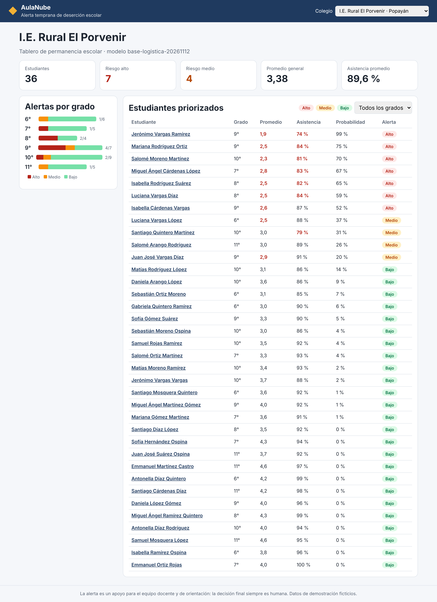
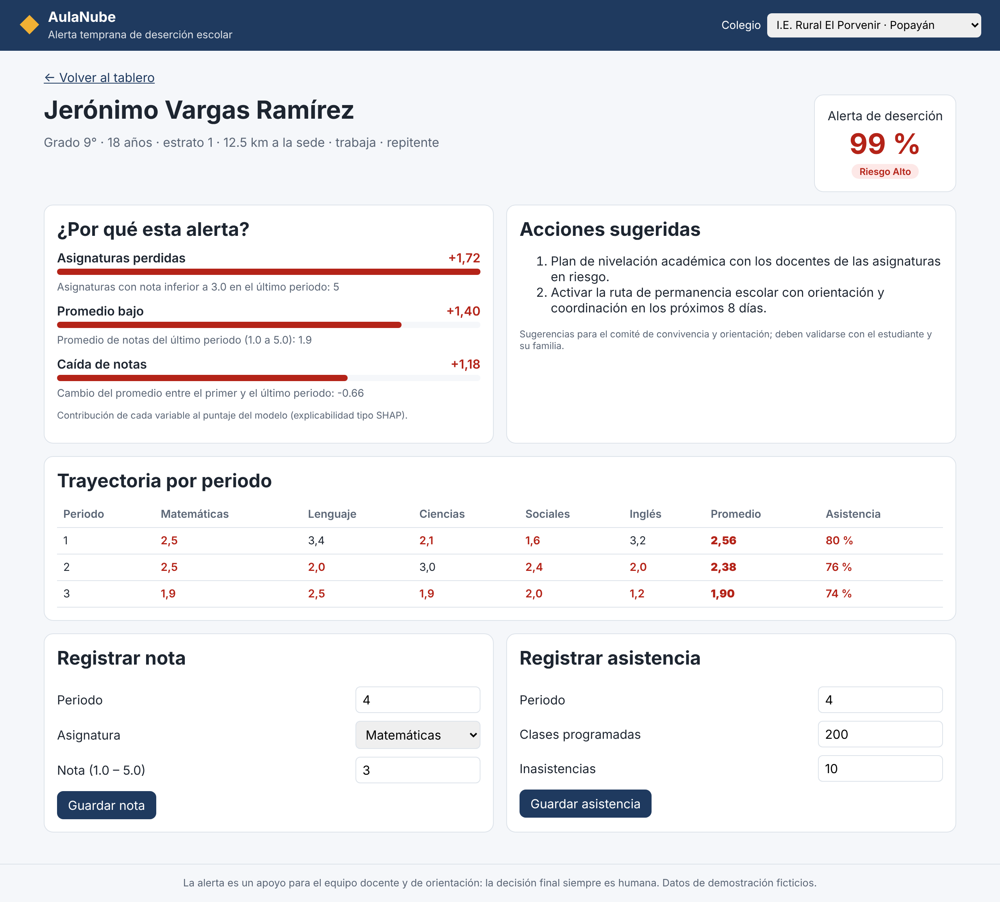
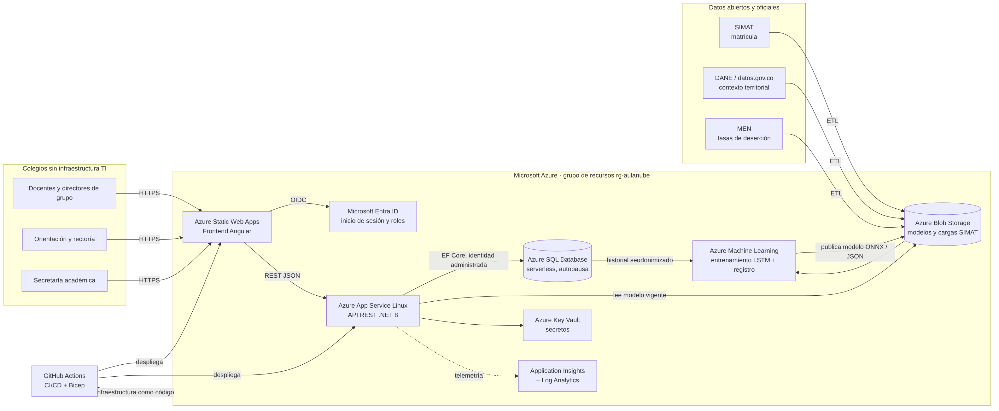

# AulaNube: alerta temprana de deserción escolar en la nube

> **Taller ABP: Proyecto y Material Técnico (20 %)**
> Elemento de competencia 1: fundamentos teóricos, aplicación y aspectos éticos de la inteligencia artificial para resolver situaciones propias de la organización.

AulaNube es una plataforma SaaS en **Microsoft Azure** para **colegios públicos que no tienen infraestructura tecnológica propia** (sin servidores, sin software académico, sin personal de TI). Desde un navegador, los docentes registran notas y asistencia; un modelo de IA analiza la trayectoria de cada estudiante y genera una **alerta temprana de deserción escolar** explicada, con acciones sugeridas para orientación escolar.

- **Frontend:** Angular 18 en Azure Static Web Apps
- **Backend:** API REST en .NET 8 en Azure App Service
- **IA:** red LSTM + MLP (modelo objetivo, Azure Machine Learning) y regresión logística como línea base (en uso en el prototipo)
- **Infraestructura como código:** Bicep + GitHub Actions

| Tablero del colegio | Ficha con alerta explicada |
|---|---|
|  |  |

---

## 1. Descripción

### Situación problema

En muchos colegios oficiales, sobre todo rurales, las notas y la asistencia se llevan en papel o en hojas de cálculo sueltas. Nadie cruza a tiempo la caída de las notas, el aumento de las inasistencias y el contexto del estudiante (extraedad, trabajo, distancia a la sede), así que la deserción se descubre cuando el estudiante ya se fue. Estos colegios tampoco pueden comprar servidores ni contratar personal para construir sus propias soluciones.

### Solución

| Qué hace AulaNube | Cómo |
|---|---|
| Elimina la barrera de infraestructura | Todo corre en Azure (PaaS); el colegio solo necesita un navegador |
| Digitaliza notas y asistencia | Formularios simples, validados, por periodo |
| Anticipa la deserción | Modelo de IA que calcula la probabilidad de deserción en cada registro |
| Explica cada alerta | Muestra los factores que más aportan al riesgo (tipo SHAP) |
| Sugiere qué hacer | Recomendaciones de la ruta de permanencia según los factores |
| Respeta a los estudiantes | Seudonimización, mínimos datos, supervisión humana obligatoria |

El análisis completo según la guía de la actividad (título, problema, variables, pregunta de investigación, impacto, elección de la red, datos, ETL, EDA, DOFA, objetivos SMART, ética, *elevator pitch*) está en **[docs/01-diseno-proyecto.md](docs/01-diseno-proyecto.md)**.

---

## 2. Arquitectura



| Capa | Servicio de Azure |
|---|---|
| Presentación | Azure Static Web Apps (Angular) |
| Lógica y API | Azure App Service Linux (.NET 8) con identidad administrada |
| Datos | Azure SQL Database serverless (autopausa) + Azure Blob Storage |
| IA | Azure Machine Learning (entrenamiento y registro del modelo) |
| Seguridad | Microsoft Entra ID, Azure Key Vault |
| Observabilidad | Application Insights + Log Analytics |
| DevOps | GitHub Actions (CI y despliegue con OIDC) + Bicep |

Detalle de decisiones, flujo de una alerta, pipeline de IA, endpoints y capas del backend: **[docs/02-arquitectura.md](docs/02-arquitectura.md)**.

### Estructura del repositorio

```
.
├── backend/                  API .NET 8 (Domain, Application, Infrastructure, Contracts, Controllers) + pruebas xUnit
├── frontend/                 Aplicación Angular 18 (tablero del colegio y ficha del estudiante) + pruebas
├── ml/                       Datos sintéticos, modelo base (NumPy) y red LSTM (PyTorch → ONNX)
├── infra/                    Bicep: toda la infraestructura de Azure
├── docs/                     Diseño según la guía, arquitectura, diagramas y evidencias
├── presentacion/             Diapositivas del proyecto (PPTX y PDF)
└── .github/workflows/        CI (build + pruebas) y despliegue a Azure
```

---

## 3. Instrucciones de ejecución y despliegue

### Requisitos

- .NET SDK 8
- Node.js 22 y npm
- Python 3.11+ (solo para regenerar el modelo)
- Para desplegar: suscripción de Azure y Azure CLI (`az`) con Bicep

### Ejecutar en local

```bash
# 1. API (.NET 8) en http://localhost:5125  (Swagger en /swagger)
cd backend
dotnet test                                  # 12 pruebas unitarias y de integración
dotnet run --project src/AulaNube.Api --urls http://localhost:5125

# 2. Frontend (Angular) en http://localhost:4200, en otra terminal
cd frontend
npm ci
npm start
```

La API carga dos colegios y 72 estudiantes **ficticios** al iniciar.

### Regenerar el modelo de IA (opcional)

```bash
cd ml
pip install numpy pandas
python generar_datos_sinteticos.py   # dataset sintético de 3.000 estudiantes y 4 periodos
python entrenar_modelo_base.py       # entrena y exporta backend/src/AulaNube.Api/Modelo/modelo-riesgo.json

# Modelo objetivo de Deep Learning (requiere PyTorch; pensado para Azure Machine Learning)
pip install -r requirements.txt
python train_lstm.py --epocas 30     # exporta ml/artefactos/modelo_desercion_lstm.onnx
```

### Desplegar en Azure

**Opción A: Azure CLI**

```bash
az login
az group create -n rg-aulanube-dev -l eastus2
az deployment group create -g rg-aulanube-dev \
  -f infra/main.bicep -p infra/main.parameters.json \
  -p sqlAdminPassword='<contraseña-segura>'

# Publicar la API (use el nombre que devuelve la salida apiNombre)
dotnet publish backend/src/AulaNube.Api -c Release -o publicacion
cd publicacion && zip -r ../api.zip . && cd ..
az webapp deploy -g rg-aulanube-dev -n <apiNombre> --src-path api.zip --type zip

# Publicar el frontend: ponga la salida apiUrl en frontend/src/environments/environment.ts
cd frontend && npm ci && npm run build
npx @azure/static-web-apps-cli deploy dist/aulanube-web/browser \
  --deployment-token $(az staticwebapp secrets list -n <staticWebAppNombre> --query properties.apiKey -o tsv)
```

**Opción B: GitHub Actions** (`.github/workflows/deploy.yml`, ejecución manual)

1. Cree una aplicación en Entra ID con credencial federada para este repositorio y rol *Contributor* + *User Access Administrator* sobre el grupo de recursos.
2. Configure los *secrets* `AZURE_CLIENT_ID`, `AZURE_TENANT_ID`, `AZURE_SUBSCRIPTION_ID` y `SQL_ADMIN_PASSWORD`, y las variables `AZURE_RESOURCE_GROUP` y `AZURE_LOCATION`.
3. En **Actions → Desplegar en Azure → Run workflow**, elija el ambiente.

---

## 4. Evidencias

| # | Evidencia | Imagen |
|---|---|---|
| 1 | Tablero del colegio rural: KPIs, alertas por grado y estudiantes priorizados por probabilidad | [01-tablero-colegio-rural.png](docs/evidencias/01-tablero-colegio-rural.png) |
| 2 | Filtro de estudiantes con riesgo alto | [02-filtro-riesgo-alto.png](docs/evidencias/02-filtro-riesgo-alto.png) |
| 3 | Ficha del estudiante: factores explicativos, acciones sugeridas y trayectoria | [03-ficha-estudiante-explicabilidad.png](docs/evidencias/03-ficha-estudiante-explicabilidad.png) |
| 4 | Registro de una nota y recálculo inmediato de la alerta | [04-registro-nota-recalculo.png](docs/evidencias/04-registro-nota-recalculo.png) |
| 5 | Documentación OpenAPI (Swagger) de la API .NET | [05-swagger-api.png](docs/evidencias/05-swagger-api.png) |
| 6 | Vista en celular (diseño adaptable) | [06-vista-movil.png](docs/evidencias/06-vista-movil.png) |

### Pruebas automatizadas

| Componente | Pruebas | Resultado |
|---|---|---|
| Backend .NET (xUnit) | 5 unitarias del servicio de riesgo + 7 de integración de la API | 12/12 OK |
| Frontend Angular (Jasmine/Karma) | Servicio HTTP y tablero | 3/3 OK |
| Infraestructura | `bicep build infra/main.bicep` | Sin errores |

### Desempeño del modelo base (datos sintéticos, 600 estudiantes de prueba)

| Umbral | ROC-AUC | Recall | Precisión | F1 |
|---|---|---|---|---|
| Alerta media (≥ 15 %) | 0,96 | 0,91 | 0,58 | 0,71 |
| Alerta alta (≥ 40 %) | 0,96 | 0,77 | 0,77 | 0,77 |

> Estas cifras son altas porque los datos son **sintéticos** y siguen un patrón conocido; sirven para verificar que el flujo funciona de punta a punta, no como estimación del desempeño real. Con datos reales se espera un desempeño menor, que debe medirse en el piloto.

---

## 5. Ética y uso responsable

- Datos de **menores de edad**: Ley 1581 de 2012, autorización de acudientes, minimización y seudonimización del documento.
- **Explicabilidad**: cada alerta muestra sus factores principales y la versión del modelo.
- **Sin estigmatización**: la alerta es confidencial y solo sirve para ofrecer apoyo, nunca para sancionar o excluir.
- **Supervisión humana**: el sistema sugiere y el equipo docente y de orientación decide.
- **Auditoría de sesgo**: métricas por zona y sexo antes de cada versión del modelo.

## 6. Presentación

Diapositivas en [`presentacion/`](presentacion/): `AulaNube-presentacion.pptx` y su versión `AulaNube-presentacion.pdf`.

## 7. Estado y trabajo futuro

Este repositorio es un **prototipo funcional (sketch)**: el flujo completo funciona en local con datos ficticios y la infraestructura está lista para desplegarse. Pendiente para una siguiente fase: persistencia en Azure SQL con EF Core, autenticación con Entra ID, entrenar la LSTM en Azure ML con datos de un colegio piloto, modo sin conexión para sedes rurales e informes en lenguaje natural con Azure OpenAI.


## 8. Licencia

Proyecto ABP - AulaNube © 2026 de Santiago Torres está licenciado bajo CC BY-NC-SA 4.0. Para ver una copia de esta licencia, visite https://creativecommons.org/licenses/by-nc-sa/4.0/


