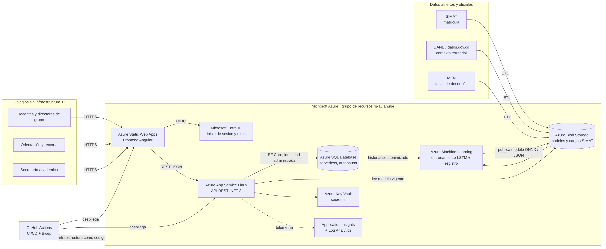
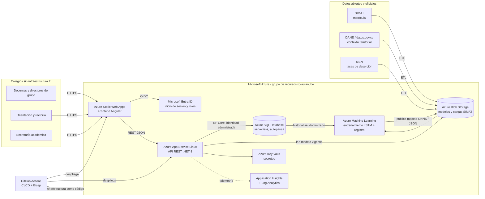
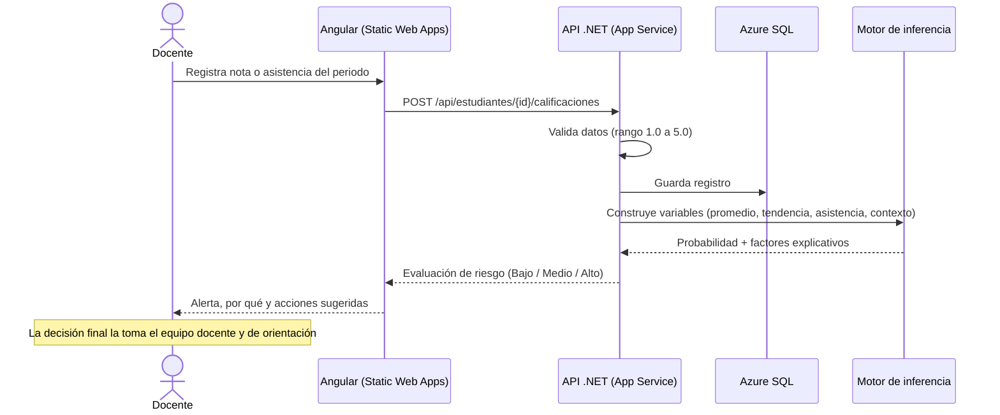

# Arquitectura técnica de AulaNube

## Vista general en Azure



<details>
<summary>Código Mermaid del diagrama</summary>



</details>

## Decisiones de arquitectura

| Necesidad del colegio | Servicio de Azure | Por qué |
|---|---|---|
| Usar la plataforma sin instalar nada | **Azure Static Web Apps** (Angular) | Hosting global con HTTPS y CDN; plan gratuito para el piloto |
| Lógica de negocio e inferencia del modelo | **Azure App Service Linux** (.NET 8) | PaaS administrado: sin servidores que mantener, escalado vertical y horizontal, ranuras de despliegue |
| Guardar notas, asistencia y estudiantes | **Azure SQL Database serverless** | SQL relacional administrado que se pausa cuando el colegio no lo usa, lo que reduce costos |
| Guardar modelos y archivos del SIMAT | **Azure Blob Storage** | Almacenamiento barato y versionable; contenedores `modelos` y `cargas-simat` |
| Entrenar la red LSTM | **Azure Machine Learning** | Cómputo bajo demanda (incluye GPU), registro de modelos, experimentos y *sweeps* de hiperparámetros |
| Proteger secretos | **Azure Key Vault** | Ninguna credencial en el código; la API accede con identidad administrada |
| Iniciar sesión por rol (docente, orientador, rector) | **Microsoft Entra ID** | Identidad centralizada; cada colegio es un inquilino lógico |
| Saber si algo falla | **Application Insights + Log Analytics** | Trazas, métricas y alertas de la API |
| Desplegar sin pasos manuales | **GitHub Actions + Bicep** | Infraestructura como código reproducible y CI/CD con OIDC (sin contraseñas en el repositorio) |

**Multi-inquilino:** un único despliegue atiende a muchos colegios; cada registro lleva `ColegioId` y la autorización filtra por el colegio del usuario. Así el costo se reparte y ningún colegio tiene que operar infraestructura.

## Flujo de una alerta



## Pipeline de IA

```mermaid
flowchart LR
    A["1. Captura<br/>SIMAT, notas, asistencia,<br/>DANE, datos.gov.co"] --> B["2. ETL<br/>limpieza, integración,<br/>seudonimización"]
    B --> C["3. Preprocesamiento<br/>escalado, secuencias<br/>por periodo, tensores"]
    C --> D["4. Entrenamiento<br/>LSTM + MLP en<br/>Azure Machine Learning"]
    D --> E["5. Evaluación<br/>ROC-AUC, recall, F1,<br/>sesgo por zona"]
    E --> F["6. Registro<br/>modelo ONNX/JSON<br/>en Blob Storage"]
    F --> G["7. Inferencia<br/>API .NET + explicación<br/>por variable"]
    G --> H["8. Prescripción<br/>acciones sugeridas<br/>ruta de permanencia"]
    H --> I["9. Visualización<br/>tablero Angular<br/>para docentes"]
```



## Capas del backend (.NET 8)

```
backend/src/AulaNube.Api
├── Domain/          Entidades (Colegio, Estudiante, Calificacion, RegistroAsistencia) y tipos de riesgo
├── Application/     ModeloRiesgo (artefacto del modelo) y ServicioRiesgo (inferencia, explicación, recomendaciones)
├── Infrastructure/  IRepositorioEscolar (puerto) + RepositorioEnMemoria y DatosSemilla (prototipo)
├── Contracts/       DTO de entrada/salida con validación (DataAnnotations)
├── Controllers/     ColegiosController, EstudiantesController
└── Modelo/          modelo-riesgo.json exportado por ml/entrenar_modelo_base.py
```

Buenas prácticas aplicadas: separación por capas e inyección de dependencias, interfaz de repositorio para cambiar la persistencia en memoria por EF Core + Azure SQL sin tocar los controladores, validación de entrada con respuestas `ProblemDetails`, documentación OpenAPI (Swagger), *health check* para App Service, telemetría opcional, configuración por variables de entorno, compilación con advertencias como errores y pruebas unitarias y de integración (`WebApplicationFactory`).

## API REST

| Método | Ruta | Descripción |
|---|---|---|
| GET | `/api/colegios` | Colegios registrados |
| GET | `/api/colegios/{id}/resumen` | Tablero: totales por nivel de alerta, promedios, alertas por grado |
| GET | `/api/colegios/{id}/estudiantes?nivel=&grado=` | Estudiantes ordenados por probabilidad de riesgo |
| GET | `/api/estudiantes/{id}` | Ficha con trayectoria por periodo y alerta explicada |
| POST | `/api/estudiantes` | Matricular estudiante (documento seudonimizado) |
| POST | `/api/estudiantes/{id}/calificaciones` | Registrar nota y recalcular alerta |
| POST | `/api/estudiantes/{id}/asistencias` | Registrar asistencia y recalcular alerta |
| GET | `/api/estudiantes/{id}/riesgo` | Solo la evaluación de riesgo |
| GET | `/health` | Estado del servicio |

## Del prototipo (sketch) a producción

| Componente | Prototipo en este repositorio | Producción |
|---|---|---|
| Persistencia | Repositorio en memoria con datos ficticios | EF Core + Azure SQL serverless |
| Modelo | Regresión logística base (pesos en JSON) | LSTM + MLP en ONNX servida con ONNX Runtime |
| Autenticación | Sin autenticación (demo) | Entra ID con roles por colegio |
| Datos | Sintéticos | SIMAT + registros reales seudonimizados, con autorización |
| Infraestructura | Bicep validado, no desplegado aún | `deploy.yml` en GitHub Actions |
